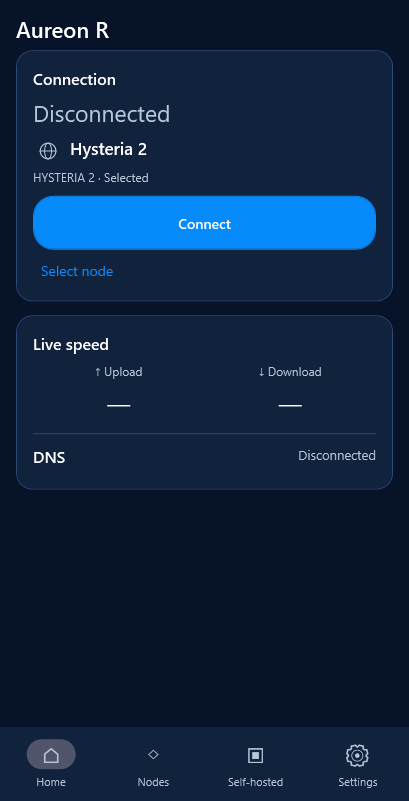
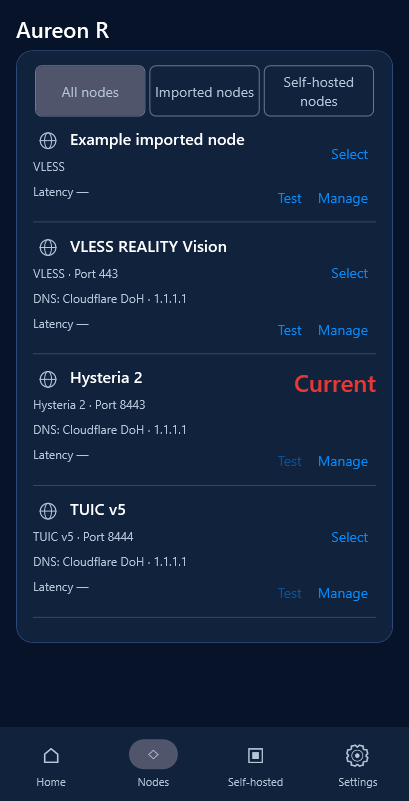
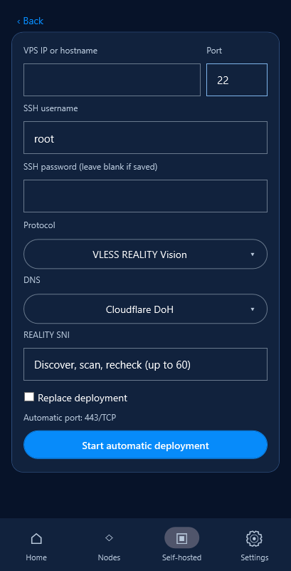
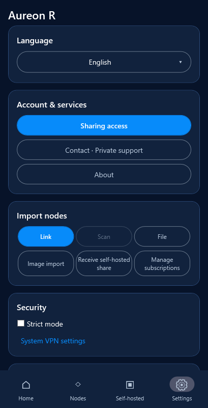
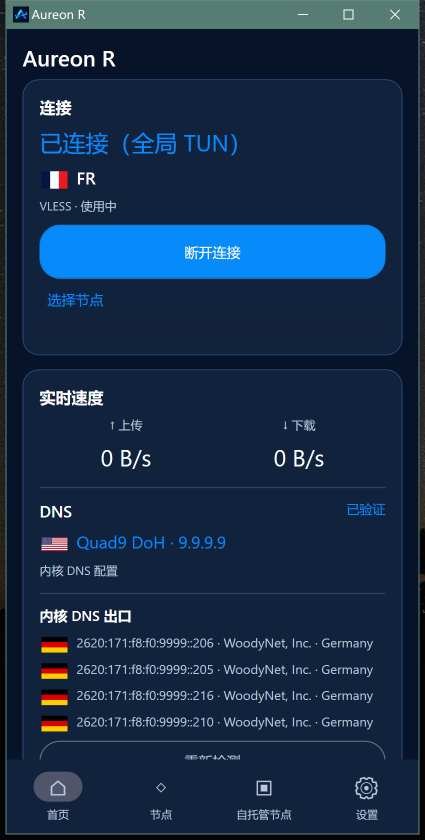

<h1 align="center">Aureon R for Windows</h1>

Your nodes. Your servers. Your control.

<strong>English</strong> · <a href="README.zh-CN.md">简体中文</a>

<a href="https://github.com/Aureon-R/aureon-r-client">Android version</a> · <strong>Windows version</strong>

<strong><a href="https://github.com/Aureon-R/aureon-r-windows/releases/latest">Download latest Windows EXE</a></strong> · <a href="https://aureonvpn.com/en/aureon-r">Official website</a>

Aureon R is an independent proxy client that supports importing your own nodes and self-hosted VPS deployment. No official proxy nodes are provided.

## App screenshots

Windows v0.1.28 interface previews with example data. Select an image to view it at full size.

<table>
<tr>
<td align="center"> <strong>Connection</strong></td>
<td align="center"> <strong>Node management</strong></td>
<td align="center"> <strong>One-click VPS deployment</strong></td>
<td align="center"> <strong>Settings and import</strong></td>
</tr>
</table>

Actual connected Windows interface (Chinese UI; private connection information masked):

## Key Features

- **Multi-protocol support:** Dual sing-box and Xray cores supporting VLESS Reality Vision, VMess TLS, Trojan TLS, Hysteria 1/2, TUIC v5, WireGuard and AnyTLS.
- **Node management:** Import links, text, files, QR code images and subscriptions. Manage, update and switch nodes. No registration is required for ordinary node use.
- **Routing & security:** Global proxy, application/domain/IP split routing, LAN bypass, strict mode, encrypted DNS (DoH) and leak protection.
- **Connection monitoring:** Real-time traffic, node latency, IP-based country and region flags, and DNS resolution verification.
- **Self-hosted deployment:** One-click Debian VPS deployment via SSH, automatic Docker and firewall configuration, and support for adding protocols, redeployment and removal.
- **Node sharing:** Share nodes via QR codes and links, with independent guest credentials, guest management and access revocation. Sharing access requires approval.
- **Backup & restore:** Encrypted backups and incremental restoration using the same account.
- **Desktop experience:** Chinese and English interface, system tray, account management, private support messaging and update checks.

## What's new in v0.1.28

- Improved leak protection and network recovery.
- Added IP-based country and region flags for nodes and DNS.
- Improved DNS resolution verification.

## Installation

Supports Windows 10/11 x64, with the .NET runtime included. In-place upgrades are supported. Exit the previous version from the system tray before installing. The EXE is not Authenticode-signed; Windows may show an unknown-publisher warning. Verify the SHA-256 checksum before running it.

---

## Links

- [Official website](https://aureonvpn.com/en/aureon-r)
- [User guide](https://aureonvpn.com/en/aureon-r/app-guide)
- [Support](https://aureonvpn.com/en/aureon-r/contact)

## Third-party components

- [sing-box 1.14.4 — GPL-3.0](https://github.com/SagerNet/sing-box/tree/v1.14.4)
- [Xray-core 26.10.31 — MPL-2.0](https://github.com/XTLS/Xray-core/tree/v26.10.31)
- IP Geolocation by DB-IP — CC BY 4.0.

See the accompanying third-party notices and SHA-256 checksum file.
