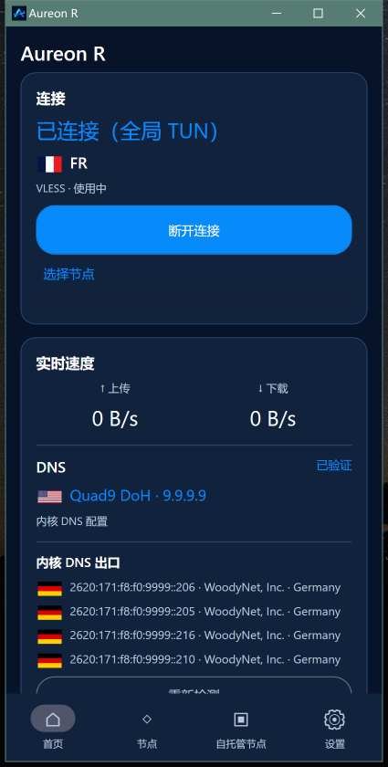
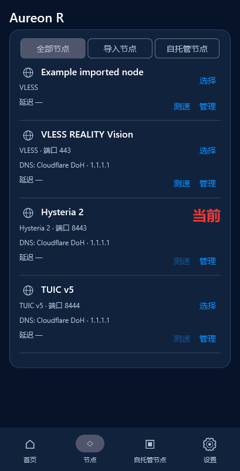
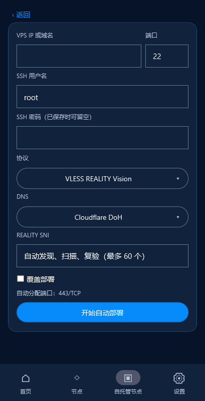
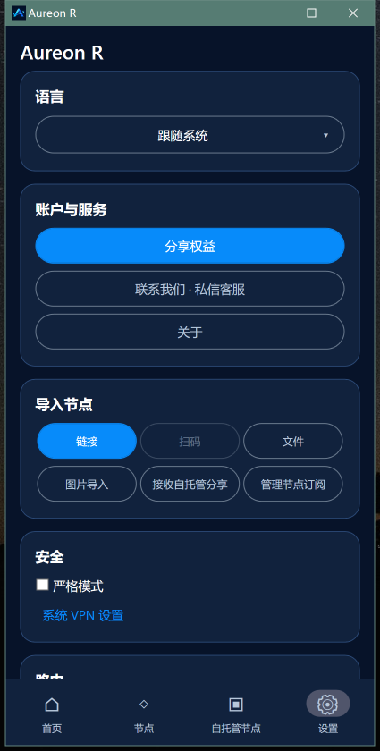

<h1 align="center">Aureon R Windows 版</h1>

你的节点，你的服务器，由你掌控。

<a href="README.md">English</a> · <strong>简体中文</strong>

<a href="https://github.com/Aureon-R/aureon-r-client/blob/main/README.zh-CN.md">Android 版</a> · <strong>Windows 版</strong>

<strong><a href="https://github.com/Aureon-R/aureon-r-windows/releases/latest">下载最新版 Windows EXE（v0.1.31）</a></strong> · <a href="https://aureonvpn.com/aureon-r?lang=zh">中文官网</a>

Aureon R 是独立代理客户端，支持用户自行导入节点及 VPS 自托管部署，不提供官方代理节点。

## APP 界面展示

首页与设置页为 Windows v0.1.28 实际运行截图，已遮盖私人连接信息；节点与部署页使用同版本示例数据展示。点击图片可查看原尺寸。

<table>
<tr>
<td align="center"> <strong>连接首页</strong></td>
<td align="center"> <strong>节点管理</strong></td>
<td align="center"> <strong>VPS 一键部署</strong></td>
<td align="center"> <strong>设置与导入</strong></td>
</tr>
</table>

## 主要功能

- **多协议支持：** sing-box 与 Xray 双内核，支持 VLESS Reality Vision、VMess TLS、Trojan TLS、Hysteria 1/2、TUIC v5、WireGuard、AnyTLS。
- **节点管理：** 支持链接、文本、文件、二维码图片及订阅导入，节点管理、更新与切换，普通节点使用无需注册。
- **路由与安全：** 全局代理、应用/域名/IP 分流、局域网绕过、严格模式、DoH 加密 DNS 及防泄漏保护。
- **连接监控：** 实时流量、全部节点一键测速、延迟排序、IP 地区旗帜及 DNS 解析验证。
- **自托管部署：** SSH 一键部署 Debian VPS，自动配置 Docker 和防火墙，支持多协议追加、覆盖及删除部署。
- **多 VPS 独立部署：** 同一账号支持多台 VPS，每台最多八种协议，新增服务器不影响已有节点。
- **节点分享：** 支持二维码和链接分享、独立访客凭据、访客管理及权限撤销。分享权益需申请开通。
- **备份与恢复：** 加密备份及同账号增量恢复。
- **桌面体验：** 中英文界面、系统托盘、账户管理、私信客服及更新检查。

## 多 VPS 独立部署

同一账号可管理多台自己的 Debian VPS，每台 VPS 拥有独立的 Docker 部署及 DNS 设置，最多部署八种支持的协议。例如美国、日本、德国三台 VPS 各部署八种协议，共 24 个节点。添加新 VPS 时填写该服务器的 IP、SSH 用户名及密码并开始部署，原服务器及节点不受影响。所有自托管节点统一管理、选择和测速。当前客户端最多保存 20 台 VPS 和 100 个节点（含导入、订阅及分享节点），属于本地容量限制，并非付费套餐限制。

## v0.1.31 更新内容

- 支持全部八种协议节点一键测速，自动按延迟升序排列，测速失败的节点排在最后。
- 修复 VPN 连接中、严格网络保护开启时无法测速的问题，无需断开 VPN 或切换当前节点。
- 测速绑定物理网卡，临时 WFP 放行规则在测速结束后自动清除，保留原网络保护。
- TCP 节点使用端口连接延迟，UDP 节点使用服务器 ICMP 延迟，不代表 UDP 协议握手成功。

## 安装说明

支持 Windows 10/11 64 位，内置 .NET 运行环境。支持覆盖升级，安装前请从系统托盘退出旧版。安装包尚未进行 Authenticode 数字签名，Windows 可能显示未知发布者提示，运行前请核对 SHA-256。

---

## 相关链接

- [官网](https://aureonvpn.com/aureon-r?lang=zh)
- [使用指南](https://aureonvpn.com/aureon-r/app-guide?lang=zh)
- [联系我们](https://aureonvpn.com/aureon-r/contact?lang=zh)

## 第三方组件

- [sing-box 1.14.4 — GPL-3.0](https://github.com/SagerNet/sing-box/tree/v1.14.4)
- [Xray-core 26.10.31 — MPL-2.0](https://github.com/XTLS/Xray-core/tree/v26.10.31)
- IP 地理位置数据由 DB-IP 提供 — CC BY 4.0。

请参阅随附的第三方许可证说明及 SHA-256 校验文件。
